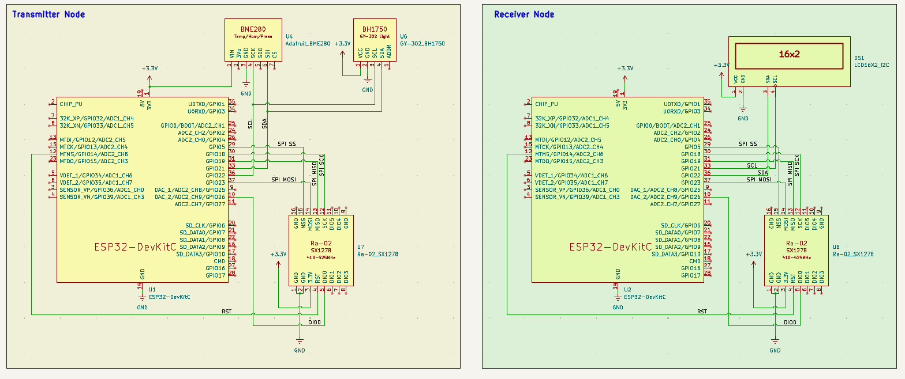

# Experiment No. 9 — LoRa Connectivity for Remote Nodes

ESP32 point-to-point LoRa lab implementation adjusted for **Ai-Thinker Ra-02 (SX1278, 433.2 MHz)**, **BME280** (temperature, humidity, pressure), **BH1750** (ambient light in lux), and a **16x2 I2C LCD** receiver display.

## Schematic Diagram

## Parts Overview (Parts A–D)

- **Part A — Establish the Link (`PART_A_TX/`, `PART_A_RX/`)**: Verifies SPI initialization and basic point-to-point LoRa communication (`433.2 MHz`, `SF7`, `BW 125 kHz`, `CR 4/5`, `Sync 0x34`, `14 dBm`) with simple ping packets and bench RSSI/SNR checks.
- **Part B — 9-Byte Packed Payload (`PART_B_TX/`, `PART_B_RX/`)**: Reads BME280 and BH1750 over I2C, packs 5 fields (`tempC`, `humPct`, `presHpa`, `lux`, `flags`) into a 9-byte big-endian binary payload (vs. ~67-byte JSON), and unpacks them onto the receiver's Serial Monitor and 16x2 I2C LCD.
- **Part C — Distance & Spreading Factor (`PART_C_TX/`, `PART_C_RX/`)**: Evaluates maximum reliable range and signal strength between **SF7** and **SF12** under NLOS (PDA Room to 2F OZ Hallway with `~31.70 m` vs. `~37.49 m` respectively) and LOS (CT Entrance to road entrance between Botanical and ST Bldg. with `~50.59 m` vs. `~80.61 m` respectively).
- **Part D — Airtime & Duty-Cycle Compliance *(Analysis Only)***: Derives packet airtime and minimum 1% duty-cycle reporting intervals for the 9-byte payload (`41.22 ms` / `4.12 s` at SF7 vs. `991.23 ms` / `99.12 s` at SF12) and selects the optimal SF for a 2 km node reporting 4 times/hour (`900 s`).

*(`IoT-Lab-9-Schematic/` contains the KiCad schematic project files.)*
